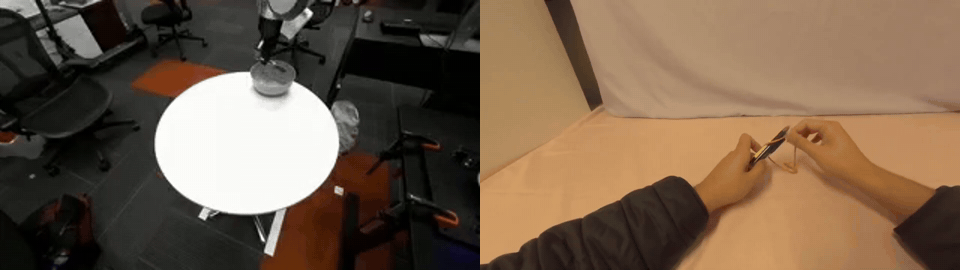
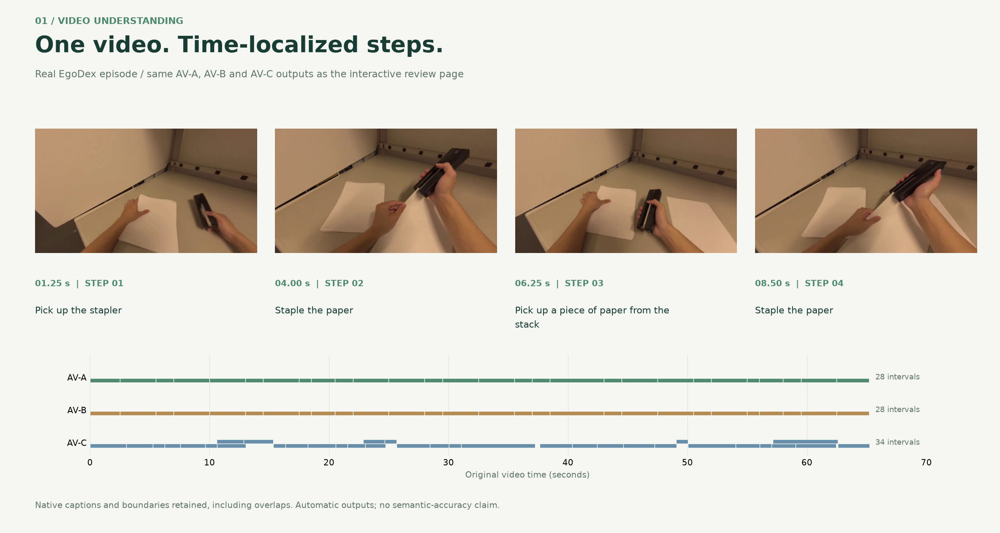
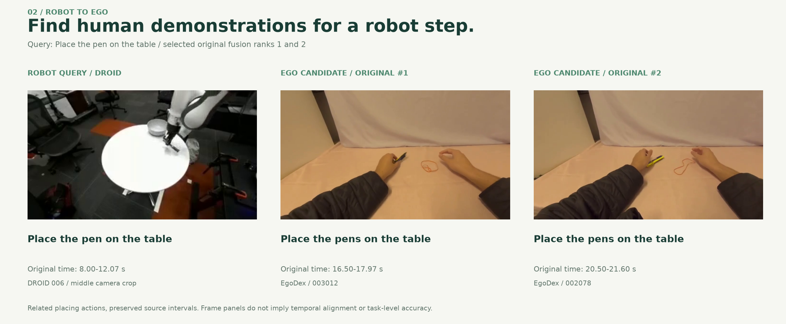
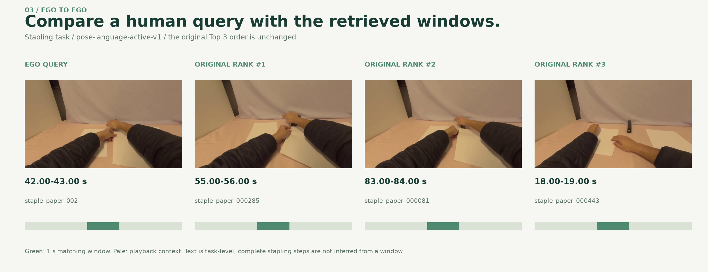
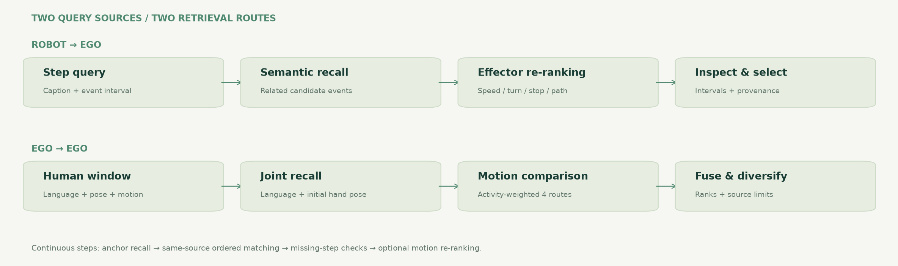

# Embodied Data Pipeline

**Understand manipulation videos. Retrieve related demonstrations. Keep time-localized, traceable samples.**

[Real examples](#real-examples) · [Retrieval framework](#retrieval-framework) · [Visual HTML](docs/showcase.html?raw=1) · [Code and reproduction](#code-and-reproduction)

### Robot demonstration → human demonstration



*Left: a DROID robot query, shown through the middle camera. Right: the selected EgoDex candidate. Each clip plays at original speed; the shorter human clip holds its final frame. Simultaneous playback is not temporal alignment.*

## Real examples

### 1. Understand a video as tasks and steps



The same video can be explored through three annotation routes. Frames, descriptions and time boundaries come from the existing run, including native overlaps. The full HTML lets you click an interval to inspect the corresponding moment.

| Route | Segmentation | Description |
|---|---|---|
| AV-A | EgoANT-based coarse/refined boundaries | Configured Qwen captioning route |
| AV-B | The same cached boundaries as A | Flora Captioner |
| AV-C | Flora native temporal segmentation | Flora Captioner |

These are automatic outputs for review, not manually corrected ground truth.

### 2. Query with a robot demonstration



A single **place-the-pen** step retrieves related human placing demonstrations. The example retains original fusion ranks 1 and 2 and their source intervals. Query scope and candidate scope remain visible rather than being hidden behind one similarity score.

### 3. Query with an egocentric human demonstration



The Ego query uses the existing pose/language/motion route. These are the original Top 3 windows for the shown query. Green marks the actual one-second retrieval window; the pale region is playback context. Official task language describes the episode, not a separately verified action label for every window.

## Retrieval framework



- **Robot → Ego:** a step description recalls semantic candidates; available observed-effector motion provides a small, bounded re-ranking signal.
- **Ego → Ego:** language and initial hand pose form a joint recall stage; four activity-weighted motion routes are compared and their ranks combined.
- **Continuous steps:** key-step anchors are expanded through ordered, same-source matching, with explicit mappings and missing-step evidence before optional motion re-ranking.

The shown cases are selected examples, not an aggregate accuracy or improvement claim. [Figure sources and exact identities](docs/visuals/SOURCES.json).

## Explore the HTML

**[Download the standalone visual HTML](docs/showcase.html?raw=1)** and open it locally. It embeds the figures and animation, so it needs no Python setup or server. If GitHub opens its source view, use **Download raw file**.

The complete video/timeline review interface is preserved in [website/](website/README.md): switch annotation methods, inspect both query sources, jump to original intervals, compare candidates and export sample JSON/CSV. The standalone HTML above is a lightweight visual export of those results; it does not run inference or replace the full video controls.

---

## Code and reproduction

This repository includes the main pipeline and an optional Ego2Robot reproduction/engineering implementation. It is currently a private preparation snapshot; original-code licensing and public distribution of selected visuals remain under review. Full datasets, learned weights and private run outputs are excluded.

### Modules

| Module | Entry point | Scope |
|---|---|---|
| Annotation | `edp-annotate` | AV-A/B/C wrappers, pinned sources, prompts/schemas, budgets and identity-bound caches |
| Retrieval | `edp-retrieve`, `edp-sequence` | Ego/Robot routes, sequential matching and optional effector-motion re-ranking |
| Selection | `edp-pipeline` | Baseline orchestration, source/task/overlap limits, eligibility and draft export/readback |
| Artifact bundles | `edp-bundle` | Bounded integration with explicit inventories and source references |
| Optional robotization | `e2r` | Actual source, geometry, profiles and isolated workers; original review rules retained |
| Showcase | `website/` | Frozen real examples, HTML interaction and figure export |

### Installation

Use Python 3.11+ and install FFmpeg / ffprobe on PATH. From the repository root:

```sh
python -m venv .venv
# Activate the environment using the command appropriate to your shell.
python -m pip install "./packages/pipeline[annotation,io]"
edp-demo --out ./outputs/synthetic-demo
```

Use a new output directory. This no-data example generates three synthetic pose sequences, indexes nine windows, returns two candidates and reads saved motion features. Its fixed semantic vectors involve no language inference. The real examples above are separate precomputed results.

For semantic inference, install the `semantic` extra and explicitly prepare the encoder. For the optional robotization source package:

```sh
python -m pip install -e ./packages/ego2robot
# Select video/data/robot extras for the stages you use.
e2r --help
```

Robotization currently uses an editable source installation so model geometry, profiles and worker scripts remain available.

### Build the full review interface

```sh
python website/build_showcase.py
python website/preview_server.py
```

Without separately supplied media, the generated page provides metadata and processing logic with explicit media placeholders. Attach the selected local clips using:

```sh
python website/build_showcase.py --media-root /path/to/selected-media
```

The external directory contains the `assets/showcase/` files listed in `website/showcase.json`. The figures in this README are already included; full source videos remain external.

### Documentation and validation

[Usage](docs/USAGE.md) · [Migration](docs/MIGRATION.md) · [Continuous queries](docs/CONTINUOUS_SUBTASK_V1.md) · [Motion re-ranking](docs/MOTION_RERANKING_V2.md) · [Third-party sources](docs/THIRD_PARTY.md) · [Validation](docs/VALIDATION.md)

The first source snapshot passed 133 existing checks with 2 private-data/history checks skipped. Installation and program completion are separate from semantic accuracy, robot geometry/visual acceptance and downstream training benefit. The draft export is not an official LeRobot compatibility claim.

```text
packages/pipeline/    annotation, retrieval, selection, quality, readers and exports
packages/ego2robot/   robotization source, profiles, geometry and isolated workers
website/             full review interface, frozen manifest and figure exporter
docs/visuals/        real-source figures and provenance
docs/showcase.html   self-contained visual gallery
scripts/             release preparation checks
```

*Sources: EgoDex and DROID for the selected demonstrations; EgoANT, Flora and the retained upstream components for their respective methods. This is an independent reproduction/engineering project, not their official implementation. Upstream attribution and terms remain separate.*
