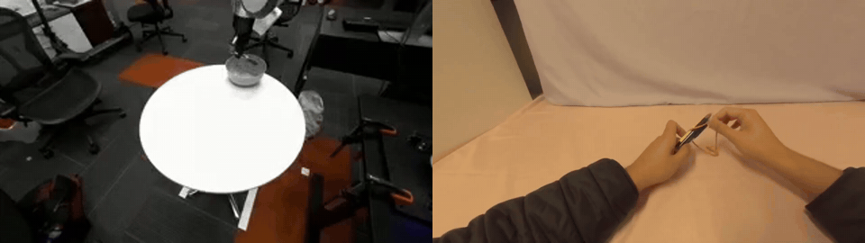
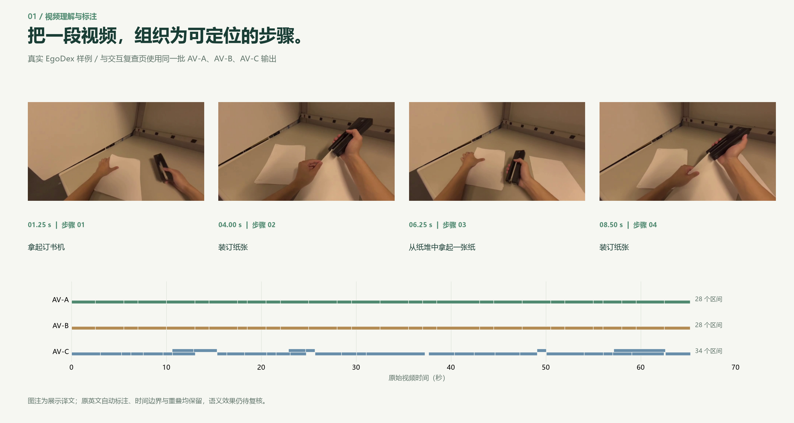
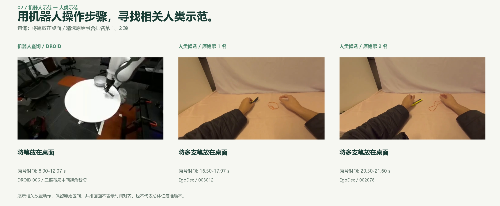
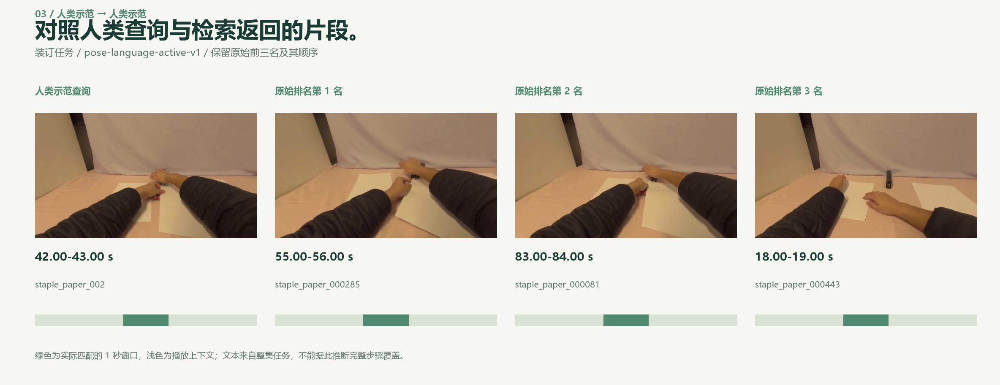
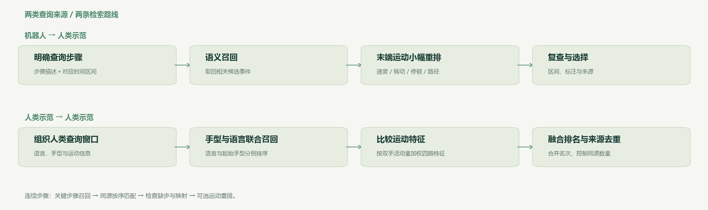

# Embodied Data Pipeline

[English](README.md) · [简体中文](README.zh-CN.md)

**理解操作视频，检索相关示范，筛选时间可定位、来源可追溯的样本。**

[真实实例](#真实实例) · [检索框架](#检索框架) · [图文 HTML](docs/showcase.zh-CN.html?raw=1) · [代码与复现](#代码与复现)

### 从机器人示范，找到相关人类示范



*左侧是 DROID 机器人查询的中间摄像头视角，右侧是选中的 EgoDex 人类候选。两段视频各自原速播放，较短的人类片段停留在末帧；同时播放不表示动作已按时间对齐。*

## 真实实例

### 1. 把视频组织为任务与步骤



同一段视频可以通过三条标注路线查看。画面、描述和时间边界均来自已有运行，保留原始重叠区间。完整交互页支持点击区间，跳转到对应时刻。

| 路线 | 时间分割 | 步骤描述 |
|---|---|---|
| AV-A | 基于 EgoANT 的粗分割与边界细化 | 配置的 Qwen 描述路线 |
| AV-B | 复用 A 的同一份缓存边界 | Flora Captioner |
| AV-C | Flora 原生时间分割 | Flora Captioner |

这些是供复查的自动输出，尚未人工修正为标准答案。图中的中文动作描述仅为展示译文，原始英文标注保留在数据中。

### 2. 用机器人示范发起查询



以一个明确的**将笔放在桌面**步骤，检索相关的人类放置示范。这里保留原始融合排名第 1、2 项及其来源区间，并同时展示查询与候选各自覆盖的范围，便于检查匹配内容。

### 3. 用第一视角人类示范发起查询



Ego 查询使用已有的手型、语言与运动检索路线。图中展示该查询的原始前三名：绿色表示实际匹配的 1 秒窗口，浅色表示播放上下文。官方任务文本描述整段示范，并非每个窗口经过独立验证的动作标签。

## 检索框架



- **Robot → Ego：**用步骤描述召回语义相关候选；在具备观测末端运动时，以其作为幅度受限的辅助重排信号。
- **Ego → Ego：**先用语言与起始手型联合召回，再比较按活动量加权的四路运动特征，合并各路排名。
- **连续步骤查询：**从关键步骤锚点扩展，在同一来源内按顺序匹配；显式保留步骤映射与缺步证据，随后可选末端运动重排。

以上为精选样例，总体准确率与效果提升仍需另行评测。[配图来源与精确标识](docs/visuals/SOURCES.json)。

## 打开图文 HTML

**[下载中文版独立图文 HTML](docs/showcase.zh-CN.html?raw=1)** 后可直接在本机打开。配图与动图全部嵌入文件，无须配置 Python 或启动服务。如果 GitHub 显示源码，请点击 **Download raw file**。[英文版 HTML](docs/showcase.html?raw=1) 使用相同样例。

完整的视频与时间轴交互界面保留在 [website/](website/README.md)：切换标注方法、查看两类查询、跳转原始区间、对照候选，并导出样本 JSON/CSV。上面的独立 HTML 是便于浏览的图文展示版；完整视频控制位于交互界面，展示页本身不运行推理。

---

## 代码与复现

仓库包含主 Pipeline，以及可选的 Ego2Robot 复现与工程实现。当前为私有整理版本，原创代码许可证和精选素材的公开分发仍在核查。完整数据集、模型权重及私有运行产物未纳入仓库。

### 模块

| 模块 | 入口 | 内容 |
|---|---|---|
| 自动标注 | `edp-annotate` | AV-A/B/C 封装、固定版本来源、提示词与结构、预算和绑定输入身份的缓存 |
| 检索 | `edp-retrieve`、`edp-sequence` | Ego/Robot 路线、连续步骤匹配、可选末端运动重排 |
| 筛选与编排 | `edp-pipeline` | 基线编排、来源/任务/重叠限制、适用性检查、草案导出与读回 |
| 产物包 | `edp-bundle` | 有明确清单和来源引用的受限集成 |
| 可选 Robotization | `e2r` | 实际源码、几何模型、配置与隔离执行脚本，保留原有审阅规则 |
| 展示页 | `website/` | 冻结的真实样例、HTML 交互与配图导出 |

### 安装

使用 Python 3.11 及以上版本，并将 FFmpeg / ffprobe 加入 PATH。在仓库根目录运行：

```sh
python -m venv .venv
# 按当前 shell 的方式激活环境。
python -m pip install "./packages/pipeline[annotation,io]"
edp-demo --out ./outputs/synthetic-demo
```

请使用新的输出目录。这个无需外部数据的示例会生成 3 条合成姿态序列，索引 9 个窗口，返回 2 个候选，并读回保存的运动特征；其中的语义向量是固定输入，不涉及语言模型推理。页面前部的真实实例来自另外保留的预计算结果。

如需语义推理，安装 `semantic` 扩展并单独准备编码器。可选 Robotization 源码包的安装方式为：

```sh
python -m pip install -e ./packages/ego2robot
# 按使用的阶段选择 video/data/robot 扩展。
e2r --help
```

Robotization 当前采用可编辑源码安装，以保留模型几何、配置和执行脚本的访问路径。

### 构建完整交互界面

```sh
python website/build_showcase.py
python website/preview_server.py
```

未单独提供媒体文件时，生成的页面仍可查看元数据与处理逻辑，并明确显示媒体占位提示。接入准备好的本地片段：

```sh
python website/build_showcase.py --media-root /path/to/selected-media
```

外部目录应包含 `website/showcase.json` 中列出的 `assets/showcase/` 文件。README 配图已纳入仓库，完整源视频仍由外部提供。

### 文档与验证

[使用说明](docs/USAGE.md) · [迁移说明](docs/MIGRATION.md) · [连续步骤查询](docs/CONTINUOUS_SUBTASK_V1.md) · [运动重排](docs/MOTION_RERANKING_V2.md) · [第三方来源](docs/THIRD_PARTY.md) · [验证记录](docs/VALIDATION.md)

首批源码快照通过 133 项已有检查，另有 2 项依赖私有数据或历史环境的检查跳过。安装与程序运行结果、语义准确性、机器人几何与视觉验收、下游训练收益需分别判断。当前草案导出尚未宣称通过官方 LeRobot 兼容性验证。

```text
packages/pipeline/       标注、检索、筛选、质量、reader 与导出
packages/ego2robot/      Robotization 源码、配置、几何与隔离执行脚本
website/                完整交互界面、冻结清单与配图导出器
docs/visuals/           真实来源配图与溯源记录
docs/showcase.html      英文独立图文展示
docs/showcase.zh-CN.html 中文独立图文展示
scripts/                发布准备检查
```

*来源：所选示范来自 EgoDex 与 DROID；EgoANT、Flora 及保留的上游组件分别用于对应方法。本仓库为独立复现与工程项目，并非上述项目的官方实现。上游署名与使用条款分别保留。*
