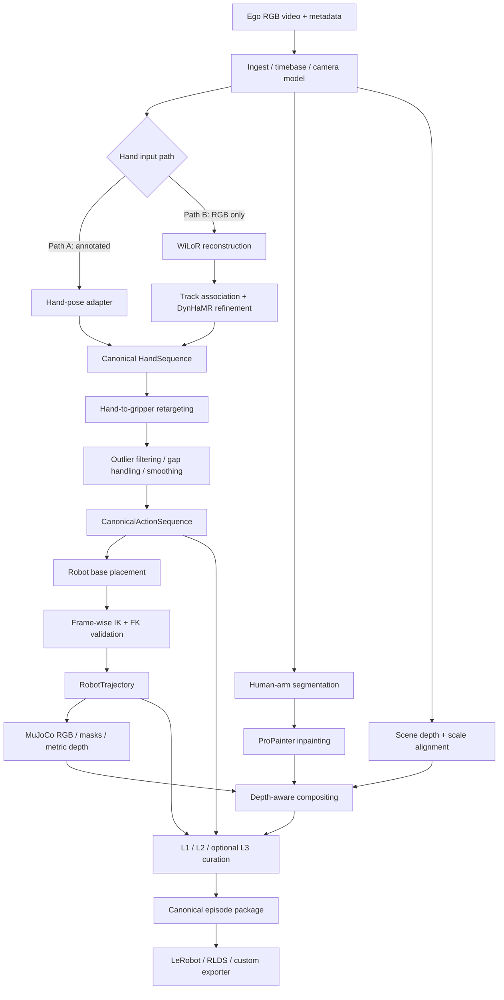

# Ego2Robot 数据处理链路系统设计

状态：`v0.1 / normative`  
更新时间：`2026-09-20`  
适用范围：本仓库后续全部数据链路代码、测试、配置与数据产物

> 2026-09-26 开发补充：用户已审阅 episode 000 的 M3 投影视频并明确同意继续 M5–M8。按 [分阶段计划](m5-m8-workplan.md) 执行；本次同意只涵盖该真实片段的视觉效果，不扩大为全部里程碑验收。M5 新增独立 `segmentation` / `inpainting` stage、独立模型进程及版本化 PNG/PTS 索引，契约与旧产物迁移方式见计划“新增契约与兼容策略”和 [ADR-0011](decisions/0011-m5-runtime-and-mask-contract.md)。

## 1. 文档目的

本文定义一个可验证、可恢复、可替换组件的 Ego2Robot 数据处理系统。目标不是训练 VLA/policy，而是把第一人称人类操作视频转换为可供后续机器人学习使用的标准化样本：

```text
ego video
  -> 3D hand trajectory
  -> robot-independent canonical gripper trajectory
  -> robot-specific joint trajectory
  -> robot-composited video
  -> quality-controlled canonical dataset
```

本文是架构、接口和数据语义的规范源。具体实现顺序与验收条件见 [`implementation-plan.md`](implementation-plan.md)。当代码与本文冲突时，应先修改设计并记录原因，不能让实现默默偏离设计。

## 2. 依据、证据等级与复现边界

### 2.1 资料优先级

1. [Ego2Robot 论文 HTML 与附录](https://arxiv.org/html/2608.02580)
2. [Ego2Robot 官方项目页](https://www-ye.github.io/ego2robot_blog/)
3. 作者后续发布的官方代码（截至 2026-09-20 尚未发布）
4. [BAp3r/Ego2Robot 第三方复现](https://github.com/BAp3r/Ego2Robot)，只用于实现参考

截至 2026-09-20，官方项目页的 Code 按钮仍指向 `#`。第三方复现也明确把论文未说明处单独列为假设，因此本项目不得把第三方参数当成官方事实。

### 2.2 设计中的证据标签

- **[PAPER]**：论文正文或附录明确给出。
- **[ENGINEERING]**：为可维护性、可测试性和工程落地做出的本项目决策。
- **[OPEN]**：论文未充分说明，必须通过实验或 ADR 决定。

### 2.3 当前范围

包含：

- 视频摄取与相机元数据管理；
- Path A（已有 3D hand pose）和 Path B（纯 RGB）输入；
- hand-to-gripper retargeting、异常过滤、补帧与平滑；
- Franka Panda 优先的 base placement、IK、FK 验证和 MuJoCo 渲染；
- 人臂分割、视频修复、场景深度与遮挡合成；
- L1/L2 质量筛选，L3 接口预留；
- canonical dataset 和后续 LeRobot 等格式的导出适配层；
- 调试可视化、阶段缓存、血缘与可复现实验记录。

不包含：

- VLA/policy 训练与模型评测；
- RoboTwin/EBench 训练基准复现；
- 大规模语言标注生产系统；
- 首个闭环之前的 15 种机器人并行支持；
- 首个闭环之前的双臂和任意互联网视频鲁棒性。

## 3. 核心设计原则

1. **先几何闭环，后视觉替换。** 机器人 EEF 投影不能与手轨迹对齐时，禁止进入分割、修复和合成阶段。
2. **感知与机器人解耦。** Hand perception 只能输出标准手部记录；不能直接输出 Franka joint。
3. **保留绝对状态，再派生训练 action。** 内部持久化绝对 `T_C_TCP`，同时生成 camera-frame relative 7D action，避免导出格式反向限制上游。
4. **坐标系显式。** 所有位姿变量必须带源/目标 frame，禁止使用含义不明的 `pose`、`transform`。
5. **阶段产物可检查、可恢复。** 每个 stage 都有输入摘要、配置哈希、版本、状态、输出清单和 QC 结果。
6. **官方事实与工程假设分离。** 未公开的相机估计、深度尺度、阈值等必须配置化并记录 ADR。
7. **小样本先行。** 从官方公开 EgoDex 测试集中选择一个 5–10 秒、单手、手持续可见的 pick–move–place episode 完成第一个闭环，再扩展 Path B、双手和长视频。

## 4. 系统上下文与主数据流



### 4.1 两条输入路径

- **Path A**：数据已提供 metric 3D hand keypoints。适合最先实现和验证主链。
- **Path B**：[PAPER] WiLoR 做逐帧 MANO/21 点重建，SAM 3 hand mask 过滤，时序关联后由 DynHaMR 优化。长视频还可由 VLM 做子任务切分。Path B 在几何 MVP 之后实现。

两条路径必须汇合到同一个 `HandSequence`，其后的模块不得知道 hand pose 来自哪个模型。

## 5. 坐标、单位和时间规范

### 5.1 Frame 命名

- `C`：相机光学坐标系，默认 `+x` 向右、`+y` 向下、`+z` 向前。
- `W`：可选场景世界坐标系；没有可靠标定时不得伪造。
- `B`：机器人 base frame。
- `E`：机器人模型的末端执行器 link frame。
- `TCP`：parallel gripper 的工具中心点及 canonical grasp frame。
- `H`：输入 hand/MANO 局部 frame，只允许存在于 adapter 内部。

### 5.2 Transform 规则

`T_A_B` 表示把 `B` 中的点变换到 `A`：

```text
p_A = T_A_B @ p_B
T_A_C = T_A_B @ T_B_C
T_B_A = inverse(T_A_B)
```

从 camera-frame TCP 目标到 robot-base IK 目标：

```text
T_B_TCP = inverse(T_C_B) @ T_C_TCP
```

持久化边界统一使用：

- 长度：米；
- 时间：秒，单调递增；
- 角度：弧度；
- quaternion：`[qx, qy, qz, qw]`，即 `xyzw`；
- 图像：RGB；OpenCV BGR 只能存在于 adapter 内；
- 深度：米；非 metric 深度必须显式标为 `relative`。

### 5.3 时间基准

- 视频的 PTS 是主时钟；不能默认 `frame_index / nominal_fps` 等于真实时间。
- 每个逐帧产物都必须保存 `frame_index`、`timestamp_s` 和 `valid`。
- 重采样、速度对齐只能生成新 timebase，不得覆盖原始时间戳。

[PAPER] 论文在训练取样阶段按数据源降低动作速度：ANT/EgoDex 保留原帧率的 60%，EgoVerse 45%，ViTRA 25%。本项目不在 canonical 产物中破坏性改帧；速度对齐由 exporter/training-view profile 生成派生索引，并保留原始 PTS。未知数据源不得套用这些比例。

## 6. 核心数据契约

所有 schema 都必须含 `schema_version`。数组 shape、dtype、frame 和 unit 必须在 schema 中验证，不能依赖注释约定。

### 6.1 `EpisodeManifest`

```yaml
schema_version: ego2robot.episode.v1
episode_id: ep_000001
source:
  video_uri: source/video.mp4
  sha256: "..."
  source_dataset: local
timebase:
  num_frames: 180
  nominal_fps: 30.0
camera:
  model: pinhole
  width: 1920
  height: 1080
  K: [[fx, 0, cx], [0, fy, cy], [0, 0, 1]]
  distortion: [k1, k2, p1, p2, k3]
  calibration_source: calibrated
  confidence: 1.0
task:
  instruction: pick up the cup and place it down
provenance:
  config_hash: "..."
  code_revision: "..."
```

### 6.2 `HandSequence`

必需数组：

```text
timestamp_s           float64 [T]
frame_index           int64   [T]
keypoints_C_m         float32 [T, H, 21, 3]
keypoints_uv_px       float32 [T, H, 21, 2]
handedness            int8    [T, H]       # -1 left, +1 right, 0 unknown
detection_confidence  float32 [T, H]
valid                 bool    [T, H]
```

可选数组：MANO pose/shape、mesh、SAM hand mask、per-keypoint confidence。

**双手语义（2026-11-02，ADR-0021）**：`H` 轴本来就是契约的一部分，`hand`/`retarget` 现已支持 `H=2`（`configs/pipeline/bimanual.yaml`），顺序由配置 `hand.selection`/`hand.sides` 决定，Path A 默认 `[right, left]`。

- 稳定身份写在 npz `meta.hand_ids`、`hand/provenance.json` 和各 stage metrics 中；`H>1` 而没有 `hand_ids` 视为校验错误，`H=1` 且缺失只给 warning（按 `handedness` 恢复身份）。
- `hand_ids` 必须与 `handedness` 符号一致（right `+1`、left `-1`，论文附录 A.3）；冲突即报错。
- 两手共享解码帧范围、PTS 与 `T_W_C`；缺失帧保留槽位并置 `valid=false`，静止手仍可 valid，逐帧不换槽、不借另一手数据。
- 逐手有效性另存 `hand/validity-per-hand.json`（逐帧 invalid 列表）。
- 尚未迁移的消费者（robot/render/projection/quality/export/segmentation/scene_depth/composite）由 `core/capabilities.py` 声明上限并显式拒绝 `H=2`，禁止 `[:,0]` 静默丢手。

### 6.3 `CanonicalActionSequence`

这是 perception 与 robot binding 的唯一正式边界：

```text
timestamp_s           float64 [T]
T_C_TCP               float64 [T, H, 4, 4]
tcp_position_C_m      float64 [T, H, 3]
tcp_quaternion_C_xyzw float64 [T, H, 4]
gripper_width_m       float64 [T, H]
confidence            float32 [T, H]
valid                 bool    [T, H]
fallback_code         uint16  [T, H]
```

同时派生但不取代绝对位姿：

```text
delta_position_C_m    float32 [T-1, H, 3]
delta_rotvec_C_rad    float32 [T-1, H, 3]
gripper_command       float32 [T-1, H, 1]
```

[PAPER] 最终 action 为 camera-frame relative 7D：3D position delta、3D rotation vector、1D gripper。  
[ENGINEERING] 本项目以相邻绝对 `T_C_TCP` 计算 camera-frame delta：

```text
delta_position_C[t] = position_C[t+1] - position_C[t]
delta_R_C[t]        = R_C_TCP[t+1] @ transpose(R_C_TCP[t])
delta_rotvec_C[t]   = Log_SO3(delta_R_C[t])
```

该左乘定义使 rotation delta 的轴表达在 camera frame，并用非交换旋转的 golden tests 固定乘法方向。持久化 `gripper_width_m` 保留物理量；7D action 中 1D gripper 的归一化/开合命令映射由 robot/export profile 决定，论文未公开的部分必须写 ADR。若后续官方代码显示不同 convention，应新增 schema version，不能就地改变语义。

**双手与迁移（2026-11-02，ADR-0021）**：`retarget` 现在对每个手独立执行异常点过滤、gap 填充、平滑与 SO(3) 修正，四个版本（raw/filtered/final/delta）都沿已有 `H` 轴堆叠，`meta.hand_ids` 与 hand stage 一致；不引入双手耦合优化器，跨手距离/相对旋转只做诊断（`previews/tcp-relative-between-hands.png`，raw vs final 同图）。`robot` 及下游仍为单臂，`H=2` 会被明确拒绝；按手/按臂迁移见 ADR-0022。`H=1` 产物数值与路径不变（四个旧 episode 已逐值比对）。

### 6.4 `RobotTrajectory`

```text
timestamp_s           float64 [T]
qpos                  float64 [T, dof]
qvel                  float64 [T, dof]
gripper_qpos          float64 [T, gripper_dof]
T_B_TCP_target        float64 [T, H, 4, 4]
T_B_TCP_fk            float64 [T, H, 4, 4]
position_error_m      float64 [T, H]
rotation_error_rad    float64 [T, H]
ik_success            bool    [T, H]
collision_code        uint16  [T]
```

机器人配置保存 `robot_id`、MJCF/URDF 哈希、joint/link names、limits、`T_E_TCP`、最大 reach 和 home `qpos`。

`T_B_TCP_*`/`position_error_m`/`rotation_error_rad`/`ik_success` 保留 `H` 轴，但 **当前 robot stage 只写 `H=1`**：一个 `robot_id`、一个基座、一组 `qpos`。`H=2` 会被 capability guard 拒绝。

**双臂 rig（2026-11-02，ADR-0023）**：`rig` stage 处理 `H=2` canonical action，每臂单独求解并各写一份 `robot/rig/<arm_id>/trajectory.npz`（仍是上面的 `RobotTrajectory`，坐标系是该臂自己的 `B`），`meta` 记录 `arm_id`/`hand_id`/`T_C_B`。绑定显式：右手→`right_arm`、左手→`left_arm`，符号不当作机器人姿态镜像。联合场景只用于碰撞与 FK 自检：世界系取右臂基座系，左臂以 `T_BR_BL` 放置，所有 body/joint/tendon/equality/actuator 名前缀 `R`/`L`；逐帧比较联合场景 FK 与独立单臂 FK，不一致即装配错误。跨臂接触同时记录**接触点数**与**去重 body-pair**，gate 用点数（论文阈值），诊断看 pair。可见性目前只是"链体原点是否落在画面内且在相机前方"的解析代理，不是渲染遮挡；渲染/合成/owner map 属 B3，仍未实现。

### 6.5 `RenderBundle`

每帧至少包含：

```text
robot_rgb             uint8   [T, H_img, W_img, 3]
robot_mask            bool    [T, H_img, W_img]
gripper_mask          bool    [T, H_img, W_img]
robot_depth_m         float32 [T, H_img, W_img]
```

深度无效值统一为 `NaN`；背景不能用 `0 m` 冒充有效深度。

### 6.6 `QualityReport`

```yaml
schema_version: ego2robot.quality.v1
episode_id: ep_000001
valid: true
frame_valid_ratio: 0.97
metrics:
  hand_missing_ratio: 0.01
  ik_success_ratio: 0.99
  p95_position_error_m: 0.006
  p95_rotation_error_rad: 0.08
  robot_visible_ratio: 1.0
reasons: []
threshold_profile: repro_v1
```

Frame 级原因使用稳定 bit flags；episode 级报告保留原始 metrics，不能只存一个 `valid`。

### 6.7 M5 视觉索引（2026-09-26 新增）

实现定义在 `vision/m5_contracts.py`。M5 的逐帧数据使用 PNG + JSON 索引，schema 独立于 v1 几何数组：

| 索引 | schema_version | 帧字段 | 用途 |
|---|---|---|---|
| `SourceFrameIndex` | `ego2robot.m5_source_frames.v1` | frame_index、timestamp_s、path、sha256 | 从官方视频按 PTS 解码的源帧 |
| `MaskSequenceIndex` | `ego2robot.m5_masks.v1` | frame_index、timestamp_s、valid、raw_path/raw_sha256、refined_path/refined_sha256 | SAM3 原始与后处理 mask |
| `BackgroundSequenceIndex` | `ego2robot.m5_background.v1` | frame_index、timestamp_s、valid、path、sha256 | ProPainter 背景帧 |

三个索引均包含 width、height、source_video_sha256、provenance；帧号和有限时间戳严格递增，路径归一为 episode 内的相对 POSIX 路径，文件哈希必须可追溯。背景帧 valid 继承其分割输入有效性，不等于用户验收。640×360 预览恢复到 1920×1080 画布时必须在 provenance 写明推理尺寸和 `preview_only=true`。

跨模型进程使用 `ModelRequest` / `ModelResult`，分别为 `ego2robot.m5_model_request.v1` 和 `ego2robot.m5_model_result.v1`。请求带 task、episode_root、source_index_path、output_dir、可选 mask_index_path、runtime 和 parameters；返回 frame_paths 与模型 provenance。runtime 显式指定 native/WSL、解释器、官方仓库、checkpoint、revision、device 与 seed，不从无关全局环境猜模型位置。

`ArmSegmenter` / `VideoInpainter` 的模型适配边界通过上述类型化进程契约提供，调用入口为 `run_model(request, request_path, result_path)`；核心环境不直接持有 PyTorch 模型。正式帧索引发布后只引用 episode 相对路径，运行环境的 Linux 路径保留原始 provenance。临时模型输入索引的哈希明确标为 worker input，不能冒充发布后的 source-index 哈希。

迁移：`segmentation`、`inpainting` 配置采用默认值，使旧配置继续解析；原 v1 hand/action/robot/render 产物不改语义。旧 episode 通过独立 M5 profile 追加两个 stage，沿用已验收的输入与几何，禁止为了新模型重写源视频时间轴。

## 7. Hand-to-gripper 算法规范

对 wrist、thumb tip、index tip、middle tip 的 camera-frame 3D 点：

```text
p_vf  = 0.7 * p_index + 0.3 * p_middle
p_tcp = (p_thumb + p_vf) / 2
w     = norm(p_thumb - p_vf)
d     = p_vf - p_wrist
z     = s * (p_thumb - p_vf) / w
y     = normalize(cross(z, d))
x     = cross(y, z)
R_C_TCP = [x y z]
```

[PAPER] `s=+1` 为右手，`s=-1` 为左手；`x/y/z` 分别为 approach、gripper normal、jaw axis。

[ENGINEERING] 机器人侧映射必须让 canonical `z` 落在真实指间连线上（2026-10-27 实测修正）。以 Panda 为例：MJCF 的 `finger_joint` 沿 `hand` 体 `+y` 滑动，`hand` 的 `+z` 指向手指（即 approach 方向）。因此 `T_E_TCP` 的旋转必须是

```text
[[0, 1, 0],
 [0, 0, 1],
 [1, 0, 0]]
```

即 TCP `x -> hand +z`、`y -> hand +x`、`z -> hand +y`（`det = +1`）。此前误用另一支循环置换 `[[0,0,1],[1,0,0],[0,1,0]]`，把 approach 轴落在了 jaw line 上；用 MuJoCo 对执行 qpos 做正向运动学实测，参考 episode 全部 52 帧的两爪连线与命令 `z` 相差 **90.0°**、与命令 `x` 相差 **0.0°**。修正后重解 IK 52/52 成功，两爪连线与 `z` 相差 **0.0°**。

[ENGINEERING] `T_E_TCP` 的**平移深度取指腹接触中心**，在 config 构建时从手指碰撞几何导出（`pad_centre_depth_in_hand`），不能用手指 body 原点：body 在 `hand + 0.0584 z`（手指安装处），而指腹位于 `hand z ∈ [0.0979, 0.1084]`、中心 `0.1031 m`。用 body 原点会让命令的抓取点落在真实接触面之后 44.7 mm；实测"指腹中心 ↔ 人捏合点"中位误差从 **45.1 mm** 降到 **12.1 mm**（残差即位置平滑量）。细节、证据与迁移要求见 [ADR-0005](decisions/0005-franka-tcp-offset.md)。

退化处理：

- [PAPER] `w < 0.01 m` 时冻结为上一有效 orientation；
- [PAPER] `norm(cross(z, d))` 接近 0 时同样冻结；
- [ENGINEERING] 无上一有效 orientation 时该帧标为 invalid，不使用任意单位矩阵掩盖错误；
- [ENGINEERING] 输出前用 SVD/polar decomposition 检查并修正到 `SO(3)`，记录修正量。

异常和时序处理：

- [PAPER] position velocity 阈值 `max(5 * median(v), 0.9 / fps)`；
- [PAPER] rotation velocity 对应 floor 为 `10.0 / fps rad/frame`；
- [PAPER] 超阈值帧用邻帧插值，执行 2 轮；
- [PAPER] position/width 用 Savitzky–Golay：window `min(21, n)`，poly order `min(3, window-1)`；实现需把 window 修正为合法奇数；
- [PAPER] orientation 用 Gaussian-weighted SLERP：`sigma=10 frames`、kernel 21，先做 quaternion hemisphere correction；
- [PAPER] gap `<=10` 帧：position 线性插值、rotation SLERP；大 gap 回 home，并按附录的 blend length 公式平滑过渡。

## 8. Robot binding、base placement 与 IK

### 8.1 Robot adapter

每种机器人实现统一接口：

```python
class RobotModel(Protocol):
    robot_id: str
    dof: int
    max_reach_m: float
    home_qpos: NDArray

    def forward_kinematics(self, qpos) -> SE3: ...
    def solve_ik(self, target_T_B_TCP, q_init) -> IKResult: ...
    def check_collision(self, qpos) -> CollisionResult: ...
    def render(self, qpos, camera) -> RenderFrame: ...
```

首个实现只支持 Franka Panda + MuJoCo + Mink。`q[t-1]` 必须作为 `q[t]` 的初值，降低 IK branch 跳变。2026-09-28 的用户授权允许按 [ADR-0019](decisions/0019-multi-morphology-trial.md) 在已审阅的 52 帧数据上进行 UR5e、xArm7、ViperX-300 的独立几何试验；每种形态通过 `robot_id` 选择各自模型、关节映射、`T_E_TCP` 和底座搜索，不改变 robot-independent canonical 边界。试验产物须分别出图并由用户验收，不能据此宣称 M9 已完成。

### 8.2 Base placement 两级策略

- **MVP fixed-base**：[ENGINEERING] 人工给定 `T_C_B`，用于尽快完成闭环。
- **Reproduction grid search**：[PAPER] 围绕轨迹中心、按机器人 reach 生成 lateral 7 × forward 7 × vertical 5 × orientation 45 候选；过滤相机距离、过近/过远 reach；最多 20 个关键帧求 IK；使用

```text
score = feasibility_rate - 5.0 * abs(mean_reach_ratio - 0.65)
```

  Mink 配置为 quadprog、100 iterations、threshold `1e-5`。双臂时分别保留 top-5，再联合验证 25 个组合。

关键帧选择器必须是独立模块，并覆盖位置极值与 orientation change 极值，不能把“每 N 帧采样”硬编码到 base search 中。

### 8.3 IK/FK 验证

每一帧至少检查：

- solver success；
- position/rotation tracking error；
- joint limits；
- self-collision；
- 相邻 joint jump；
- FK(`qpos`) 与 target 的闭环误差。

[PAPER] L1 的 IK tracking error 有效阈值为 `<0.05 m`。  
[ENGINEERING] MVP 的几何验收使用更严格的 p95 position `<0.01 m`、p95 rotation `<0.10 rad`，以免“论文过滤合格”掩盖系统性坐标错误。

## 9. 视觉链设计

### 9.1 相机模型

渲染需要 intrinsics 和 `T_C_B`。相机来源必须为以下枚举之一：

- `calibrated`：真实标定；
- `dataset`：数据集自带；
- `estimated`：模型/启发式估计；
- `assumed`：人工假设，只能用于 debug，默认不能进入正式数据集。

[OPEN] 论文没有充分说明任意互联网视频的 intrinsics/extrinsics 获取和验证方式。本项目 MVP 要求用户提供或人工确定相机参数；自动估计单独通过 ADR 引入。

### 9.2 Human-arm segmentation

[PAPER] SAM 3 使用文本提示 `person`，以中间帧作为 prompt anchor；长视频分为 400 帧 chunk，overlap 50，重叠 mask 用 bitwise OR 合并。后处理为：

- 缺口 `<=3` 帧用邻近 masks 插值；
- mask area 小于局部 median（window 11）的 50% 时，用最近有效 mask 替换；
- `5×5` 椭圆 kernel 做 morphological close。

模块必须同时保存 raw mask 和 refined mask，以便定位过度分割造成的物体丢失。

### 9.3 Inpainting

[PAPER] ProPainter 参数：fp16、`neighbor_length=10`、`ref_stride=10`、`subvideo_length=80`、`mask_dilation=4`、RAFT iterations `20`。

MVP 允许人工 mask 或轻量 inpainting 作为 smoke test，但正式视觉验收必须使用时序一致的视频修复实现。

### 9.4 Robot rendering

MuJoCo renderer 使用原视频的相机模型输出 RGB、robot mask、gripper mask、metric depth。robot base、link geometry、lighting 和相机必须进入渲染 manifest。

### 9.5 Scene depth 与 scale alignment

[PAPER] 使用 Depth Anything V3 的 scene depth，与 MuJoCo depth 做遮挡比较。  
[OPEN] 论文未充分说明单目相对深度如何与 MuJoCo metric depth 对齐。禁止直接比较未标定的 relative depth 与米制 robot depth。

统一接口：

```python
class SceneDepthEstimator(Protocol):
    def estimate(self, frames, camera) -> SceneDepth: ...

class DepthScaleAligner(Protocol):
    def align(self, relative_depth, anchors) -> MetricDepth: ...
```

深度策略必须记录 `metric | aligned | relative` 和 confidence。只有 `metric/aligned` 可进入正式 depth compositing；`relative` 只能生成带水印/标志的 debug 结果。

[ENGINEERING] ADR-0020 落地了这一层：类型与校验在 `vision/scene_depth.py`，隔离推理在
`vision/da3_bridge.py` + `tools/da3_model_worker.py`，配置键 `scene_depth.*`，profile
`configs/pipeline/m6.yaml`。三条实现约定：

- 模型网格必须等于声明的 `work_width × work_height`，否则 worker 直接报错；米制换算用
  `focal_work_px / focal_scale_divisor`（Metric-Large 输出焦点归一化深度），不按权重
  文件名推断单位。
- 深度在**将要被合成的同一批像素**上估计（`scene_depth.input: auto` 优先修复后的背景），
  否则等于拿"有手画面"的深度去裁决"无手画面"的遮挡。
- 尺度证据分两级：TCP 锚点每集可得但落在指缝里（本集中位残差 77.8 mm），只能当粗筛；
  手部关键点参考校验在少量原始帧上重跑一次（中位残差 40.6 mm）才是可引用的证据。校验
  失败是 warning 并写进 manifest，不伪装成通过。

### 9.6 Depth-aware compositing

[PAPER] 实际实现将 robot 分成 arm body 和 gripper：arm body 总是贴到修复背景上；gripper 才做逐像素深度比较。scene 在前且像素不在 dilated hand mask 内时隐藏 gripper。hand mask 使用 `5×5` kernel 膨胀 1 次。

[ENGINEERING] 实现在 `vision/composite.py`，stage 为 `composite`（profile `m6`）：
decision map 用固定整数编码（`0` 背景、`1` arm、`2` gripper 在前、`3` gripper 被遮挡、
`4` gripper 因 hand mask 豁免保留），并输出 visible mask、occluded mask 与逐帧指标。
两条保守约定必须保留：scene depth 为 `NaN` 时视为"无证据"，不隐藏 robot；`arm body`
永不参与深度比较，否则前臂每跨过一次桌沿就会被删掉。`mode: debug_alpha` 走另一套文件名
且 `valid_episode=false`。

已知边界：本层只解决 **gripper** 的遮挡。前臂在视觉上穿过道具（如透明盒）不是合成 bug，
而是论文设定的必然结果；要修需要场景物体几何，属于新 ADR。

合成器必须输出：final RGB、visible robot mask、occluded gripper mask、compositing decision map，便于审计遮挡错误。

## 10. Quality curation

### 10.1 Preflight [ENGINEERING]

在论文 L1 之前增加不改变算法语义的输入完整性检查：解码成功、时间戳单调、K 有效、数组无非预期 NaN、shape/schema 匹配。Preflight 失败不进入昂贵阶段。

### 10.2 L1 pipeline-internal [PAPER]

Frame 有效条件：

- hand detected；
- IK tracking error `<0.05 m`；
- rendered robot visible `>0 pixels`；
- 无 MuJoCo self-collision。

额外 invalidation：

- 双臂 cross-arm contacts `>1`；
- robot mask 占图像面积 `>70%`；
- 短有效区间 `< floor(0.3 * fps)` 且夹在无效区之间时，做 stability erosion。

### 10.3 L2 statistical [PAPER]

- 对每个 action dimension，排除 L1 invalid frames 后按数据源计算 Q1/Q99；超出 `[Q1-3*(Q99-Q1), Q99+3*(Q99-Q1)]` 的帧标记异常；
- 对 state/action 计算 residual、acceleration、jerk，超过数据集逐维统计阈值的 step 标记异常；
- 总 invalid frame ratio `>60%` 的 episode 丢弃。

数据集级统计量要版本化并写入 report，禁止在线处理时随 batch 漂移。

### 10.4 L3 VLM consistency [PAPER, DEFERRED]

论文用 Qwen3.5，以 4 fps 采样 synthesized video，连同 subtask description 检查动作类型、对象类别、目标位置和执行成败。MVP 只定义接口并保留手工审核字段，不接 VLM。

## 11. 模块与目录设计

### 11.1 技术基线

| 能力 | 首选实现 | 约束 |
|---|---|---|
| 运行时 | Python 3.11 | 在 M0 固定并生成 lockfile |
| 视频/时间戳 | FFmpeg + PyAV | 以 PTS 为准，不依赖 OpenCV 的 nominal fps |
| 数值/几何 | NumPy + SciPy | persisted quaternion 统一 `xyzw` |
| schema/config | Pydantic + YAML | schema/version validation 必须在 stage 边界执行 |
| CLI | Typer | 所有重任务都支持 `--until`、resume 和 dry-run |
| Robot/physics | MuJoCo + Mink | 第一种 morphology 为 Franka Panda |
| 图像处理 | OpenCV headless | BGR 与 canonical RGB 的转换限制在 adapter 内 |
| 深度学习 adapter | PyTorch | 核心 schema/geometry/tests 不得强依赖 GPU |
| 测试 | pytest + Hypothesis | SE(3)/rotation 优先使用 property tests |

具体依赖版本在 M0 通过兼容性 smoke test 后锁定，设计文档不追随未经验证的最新版号。

### 11.2 目录结构

```text
ego2robot/
├── AGENTS.md
├── pyproject.toml
├── configs/
│   ├── pipeline/
│   │   ├── mvp.yaml
│   │   └── repro.yaml
│   ├── robot/franka_panda.yaml
│   └── quality/repro_v1.yaml
├── docs/
│   ├── system-design.md
│   ├── implementation-plan.md
│   └── decisions/
├── src/ego2robot/
│   ├── cli.py
│   ├── core/
│   │   ├── schema.py
│   │   ├── frames.py
│   │   ├── transforms.py
│   │   ├── artifacts.py
│   │   └── config.py
│   ├── pipeline/
│   │   ├── stage.py
│   │   ├── runner.py
│   │   └── registry.py
│   ├── ingest/
│   │   └── egodex.py
│   ├── perception/
│   │   ├── hand/base.py
│   │   ├── hand/path_a.py
│   │   ├── hand/wilor.py
│   │   ├── hand/tracking.py
│   │   └── hand/dynhamr.py
│   ├── retarget/
│   │   ├── hand_to_gripper.py
│   │   ├── outliers.py
│   │   ├── gaps.py
│   │   └── smoothing.py
│   ├── robots/
│   │   ├── base.py
│   │   ├── registry.py
│   │   ├── base_search.py
│   │   └── franka/
│   ├── vision/
│   │   ├── segmentation.py
│   │   ├── inpainting.py
│   │   ├── scene_depth.py
│   │   ├── rendering.py
│   │   └── compositing.py
│   ├── quality/
│   │   ├── preflight.py
│   │   ├── l1.py
│   │   ├── l2.py
│   │   └── l3.py
│   ├── export/
│   │   ├── canonical.py
│   │   └── lerobot.py
│   └── viz/
│       ├── hand_overlay.py
│       ├── frames_3d.py
│       └── projection_debug.py
└── tests/
    ├── unit/
    ├── integration/
    ├── golden/
    └── fixtures/
```

依赖方向固定为：

```text
core <- ingest/perception/retarget/robots/vision/quality/export <- pipeline <- cli
```

业务模块之间通过 `core` schema 或明确的 Protocol 交互；不得互相读取对方内部缓存文件。

所有外部库坐标约定必须封装在 adapter 内。特别是 MuJoCo camera/rendering convention 与本项目 camera optical frame 可能不同，renderer 必须包含显式 basis transform，并通过同一 3D 点的解析投影与渲染投影 golden test；禁止把 `T_C_B` 原样塞入渲染器后凭视觉试调符号。

## 12. Pipeline stage 契约

每个 stage 实现：

```python
class Stage(Protocol):
    name: str
    version: str

    def validate_inputs(self, ctx) -> ValidationResult: ...
    def fingerprint(self, ctx) -> str: ...
    def run(self, ctx) -> StageResult: ...
    def validate_outputs(self, result) -> ValidationResult: ...
```

每次运行生成 `stage-manifest.json`：

```yaml
stage: retarget
stage_version: 1
status: succeeded
input_fingerprints: {}
config_hash: "..."
code_revision: "..."
started_at: "..."
duration_s: 1.23
outputs: []
metrics: {}
warnings: []
```

要求：

- 相同 fingerprint 的成功产物可 resume；
- `--force-stage` 只重跑指定 stage 及下游；
- stage 失败写失败 manifest 和可读错误，不留下貌似成功的半成品；
- 原始 source 永不就地修改；
- 并发以 episode 为隔离单元，stage 产物先写临时目录，完成校验后原子发布。

### 12.1 视觉上游等价（ADR-0026）

人臂擦除（`segmentation` → `inpainting`）不绑定单一上游 stage，而是绑定**一个已审阅的视觉上游**：

| 上游 | 适用 | 审阅记录 | 校验 |
|---|---|---|---|
| `projection` | 单臂（历史链路，M3） | `quality/reviews/m3-video.json`（`scope: episode_projection_video`） | 记录内每个 `path` 存在且 SHA-256 一致 |
| `rig` | 双臂（ADR-0022/0025） | `quality/reviews/rig-geometry.json`（`schema_version: ego2robot.rig.review.v1`、`scope: episode_rig_geometry`） | 同上，且必须绑定 `robot/rig/rig.json` 与至少一帧 `robot/rig/render/*.png` |

规则：

- 两个上游都不 succeeded 才报错，错误码仍是 `segmentation.invalid_input`，信息里同时点名两个上游；
- 单臂分支的代码路径与指纹键集合保持不变（不因双臂支持而让历史 episode 误判过期）；
- 审阅记录里的 `reviewer` 必须是字面量 `user`，agent 不得代写（AGENTS.md 规则 2、9）；
- `core/capabilities.py` 中 `segmentation`/`inpainting` 声明 `H <= 2`：这两个 stage 不按手索引，手序列只用于校验时间基准；`scene_depth`/`composite` 仍为 `H <= 1`，因为它们的实现仍按单臂取手。

## 13. Canonical episode 存储布局

```text
data/episodes/ep_000001/
├── episode.json
├── source/
│   ├── video.mp4
│   └── camera.json
├── hand/
│   ├── sequence.npz
│   └── stage-manifest.json
├── canonical/
│   ├── actions.npz
│   └── stage-manifest.json
├── robot/franka_panda/
│   ├── base.json
│   ├── trajectory.npz
│   └── stage-manifest.json
├── robot/rig/                    # 双臂（ADR-0022/0025）：rig.json、contacts.npz、
│   ├── rig.json                  #   {right,left}_arm/trajectory.npz、render/
│   ├── contacts.npz
│   ├── right_arm/trajectory.npz
│   ├── left_arm/trajectory.npz
│   ├── render/                   #   rgb/owner/mask/depth-frame-*.png|npz + render.json
│   └── stage-manifest.json
├── visual/
│   ├── background.mp4
│   ├── robot.mp4
│   ├── synthetic.mp4
│   └── stage-manifest.json
├── masks/
├── depth/
├── quality/
│   ├── report.json
│   └── reviews/                  # 审阅记录：m3-video.json（单臂）/ rig-geometry.json（双臂）
└── previews/debug-overlay.mp4
```

MVP 使用 `NPZ + JSON + MP4/PNG`，便于检查和少量数据迭代。[ENGINEERING] 当单机样本规模证明 NPZ 成为瓶颈后，再通过 ADR 迁移到 Zarr/Parquet；不能预先引入复杂存储栈。

## 14. 配置分层

优先级从低到高：

```text
package defaults
  < pipeline profile
  < dataset/source profile
  < robot profile
  < CLI explicit overrides
```

每个落盘产物保存解析后的完整配置和 config hash。配置至少分为：

- `mvp`：Path A、单手、fixed base、Franka、robot-only render，随后逐阶段开启视觉模块；
- `bimanual`：Path A、双手（`hand.selection: both`、`sides: [right, left]`），只到 `retarget`；其余参数与 `mvp` 保持一致以便对照（ADR-0021）；
- `bimanual-rig`：在 `bimanual` 基础上追加 `rig`（两臂 rig），两臂各一套显式基座，无渲染/合成（ADR-0023）；
- `repro`：论文公开参数、full base search、L1/L2；
- `scale`：多 episode worker、资源限制、重试策略；待 MVP 后定义。

## 15. 调试与可观测性

每个 episode 默认生成轻量 preview：

- RGB 上叠加 wrist/fingertips、hand confidence；
- TCP 三轴和 gripper width；
- FK EEF 的 image projection 与 TCP target；
- invalid frame 原因和 IK error；
- compositing occlusion decision。

结构化日志必须包含 `run_id`、`episode_id`、`stage`、`frame_index`（如适用）。阶段 metrics 汇总到 manifest；大规模运行前再接外部追踪系统。

## 16. 安全与数据治理

- Ego 视频可能包含人脸、屏幕和家庭环境；原始视频与公开导出目录分离。
- 数据集 adapter 必须保留 license/source 字段；未知许可内容不能进入可发布集合。
- 任何外部模型权重都要记录来源、license、checksum 和版本。
- 调试输出不得默认上传；路径、token 和原视频 URI 不写进公共日志。

## 17. 已知风险与设计决策队列

| 风险 | 影响 | 当前控制 | 必须形成的 ADR |
|---|---|---|---|
| 单目 hand depth/metric scale 不稳定 | TCP 尺度错误、IK 全失败 | MVP 使用带 metric pose 的 Path A | Path B scale recovery |
| camera intrinsics/extrinsics 未知 | 投影和渲染错位 | MVP 要求标定/人工参数 | Camera estimation policy |
| relative scene depth 与 metric robot depth 不可直接比较 | 遮挡关系错误 | 正式合成要求 DepthScaleAligner | Depth scale alignment |
| arm mask 吃掉被操作物体 | inpainting 破坏交互对象 | 保存 raw/refined masks，视觉 QC | Object-preserving masking |
| IK 每帧跳 branch | joint trajectory 抖动 | previous q 作为初值，joint jump QC | IK solver/weights |
| 双手数据被单臂消费者静默截成单手 | 看起来正常的单手 episode，实际丢手 | `core/capabilities.py` 拒绝 `H>1` + `hand_ids` 身份契约 | ADR-0021（已实现）；按臂迁移 ADR-0022 |
| 双臂基座各自最优但联合不可用（互相碰撞/一只臂几乎不在画面里） | IK 全成功却无法合成可用画面 | 每臂独立搜索后联合场景检查接触与可见性；forward-depth 约束；逐臂+联合有效率分开报 | ADR-0023（已实现，联合搜索待做） |
| 逐手独立平滑改变两手相对位姿 | 双臂协调关系被平滑“改掉”且不可见 | 跨手距离/相对旋转曲线，raw 与 final 同图 | 是否需要双手耦合约束（待 B2 决定） |
| 论文未公开全部数据准备细节 | 难以完全数值复现 | 证据标签 + ADR | 按问题新增 |

## 18. 架构完成定义

系统只有同时满足以下条件，才可称为“数据链路 MVP 完成”：

1. 一个来自官方公开 EgoDex 测试集的 5–10 秒、单手、metric hand-pose episode 可从 manifest 一条命令运行到最终 episode；
2. hand -> TCP 可视化无系统性 flip、axis swap 或不可解释 jitter；
3. Franka IK success ratio `>=95%`，p95 FK position error `<1 cm`、p95 rotation error `<0.10 rad`；
4. robot EEF image projection 与目标 hand/TCP 在抽检帧中一致，几何 gate 有保存的证据视频；
5. renderer 产出 RGB、robot mask、gripper mask、metric depth；
6. 视觉链输出 human-removed background 和 depth-aware synthetic video，且 debug decision map 可解释遮挡；
7. L1/L2 report、canonical action、robot trajectory、配置和 provenance 完整落盘；
8. 同一输入和配置重跑结果在定义的数值容差内一致，且第二次运行可从 stage cache 恢复。
